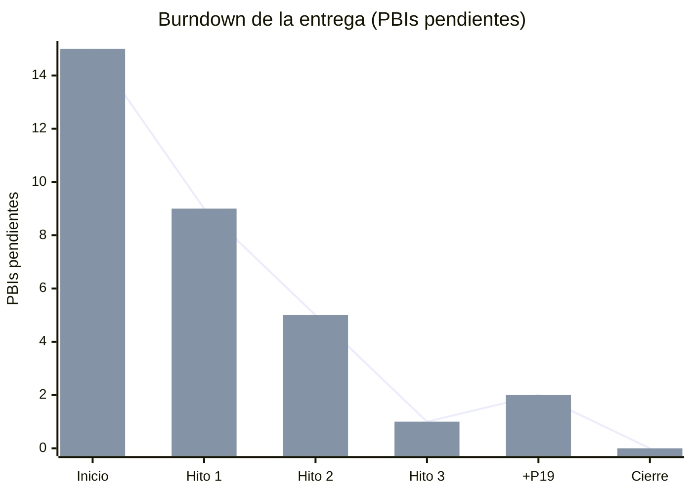

# Gestión del proyecto (DoneTonic)

Esta página reúne todo lo que se ha gestionado en **DoneTonic**, para que pueda revisarse desde el repositorio sin necesidad de entrar en la herramienta.

| Dato | Valor |
|---|---|
| Herramienta | [DoneTonic](https://app.donetonic.com) |
| Espacio de trabajo / equipo | *TFG* / *Colchoneros* |
| Sprint | **Sprint 1**, del 29/09/2026 al 27/10/2026 |
| Product Backlog | 19 PBIs (P1–P19) con 32 tareas (T1–T32), etiquetados por hito (H1–H4) |
| Prioridad | Orden del backlog de P1 a P18, siguiendo los hitos. Todos los PBIs son **MUST** porque son requisitos obligatorios del enunciado |
| Alcance de la entrega | Hitos 1, 2 y 3 (P1–P14), P18 (README y revisión) y P19 (despliegue en Google Cloud Run con los créditos de educación). El profesor ha limitado esta primera entrega a los Hitos 1–3, así que P15–P17 (Hito 4) quedan para la siguiente |

## Cómo se ha trabajado

1. **Del enunciado al backlog.** Cada requisito de la especificación del Sprint 1 se convirtió en un PBI, con descripción y criterios de aceptación. Los PBIs se agruparon por hito y se ordenaron por prioridad.
2. **Del PBI a las tareas.** Cada PBI se dividió en el menor número de tareas que tuviera sentido, entre una y dos.
3. **De la tarea al código.** Cada tarea tiene una rama propia `hito-N/Tx-descripcion`. Se integra en la rama del hito mediante un pull request titulado `[Tx] ...`, que exige el CI en verde.
4. **Cierre de hito.** La rama `hito-N/integracion` se integra en `main` con otro pull request. El despliegue continuo la publica (Render y, desde el cierre del sprint, Google Cloud Run) y se crea una release `hito-N`.
5. **Seguimiento.** Al fusionar cada PR, su tarea pasa a *HECHO* en el tablero. Cuando todas las tareas de un PBI están hechas, el PBI pasa a *HECHO*. Las gráficas de DoneTonic se actualizan solas.

### Definición de hecho (DoD)

Una tarea solo se considera **hecha** cuando cumple todo esto:

- el código está en su rama y en un PR con la referencia a la tarea;
- las pruebas automáticas pasan en el CI (check **Pruebas**);
- el PR está fusionado en la rama del hito;
- la documentación (README, `.env.example`) está actualizada si hace falta.

Un hito está **hecho** cuando su rama está en `main`, desplegada en la URL pública (https://la-grada-colchonera-1081564062572.europe-southwest1.run.app) y publicada como release.

## Capturas de DoneTonic

Estado del Sprint 1 en DoneTonic al cerrar la entrega (12/10/2026). Los Hitos 1–3, P18 y P19 están hechos; quedan pendientes los tres PBIs del Hito 4 (P15–P17), que son de la siguiente entrega.

**Tablero del Sprint 1.** Cada fila es un PBI con sus tareas repartidas por columnas de estado; los PBIs en verde están hechos.

**Gráficas de seguimiento (*Paneles Scrum*).** Sprint Burnup y Sprint Burndown: 84 % completado y 3 PBIs pendientes, los del Hito 4. En el mismo panel están también el Backlog Burndown, el Backlog Burnup y el Velocity Chart, que se completan al cerrar el sprint.

**Product Backlog y Sprint Backlog.** PBIs priorizados y etiquetados por hito, todos dentro del Sprint 1 (`#S1`, del 29/09 al 27/10).

## Backlog y estado

| PBI | Hito | Título | Estado | Entrega |
|---|---|---|---|---|
| P1 | H1 | Repositorio GitHub y flujo GitHub Flow | Hecho | [hito-1](https://github.com/VelaElDios/la-grada-colchonera-saas/releases/tag/hito-1) |
| P2 | H1 | Integración continua (CI) | Hecho | [hito-1](https://github.com/VelaElDios/la-grada-colchonera-saas/releases/tag/hito-1) |
| P3 | H1 | Despliegue continuo en URL pública | Hecho | [hito-1](https://github.com/VelaElDios/la-grada-colchonera-saas/releases/tag/hito-1) |
| P4 | H1 | Lógica de gestión de usuarios (en memoria) | Hecho | [hito-1](https://github.com/VelaElDios/la-grada-colchonera-saas/releases/tag/hito-1) |
| P5 | H1 | Pruebas unitarias automatizadas de la lógica | Hecho | [hito-1](https://github.com/VelaElDios/la-grada-colchonera-saas/releases/tag/hito-1) |
| P6 | H1 | Capa API de usuarios | Hecho | [hito-1](https://github.com/VelaElDios/la-grada-colchonera-saas/releases/tag/hito-1) |
| P7 | H2 | Frontend: interfaz y cliente de comunicación separados | Hecho | [hito-2](https://github.com/VelaElDios/la-grada-colchonera-saas/releases/tag/hito-2) |
| P8 | H2 | Registro e inicio de sesión locales | Hecho | [hito-2](https://github.com/VelaElDios/la-grada-colchonera-saas/releases/tag/hito-2) |
| P9 | H2 | Cierre de sesión y mantenimiento de la sesión | Hecho | [hito-2](https://github.com/VelaElDios/la-grada-colchonera-saas/releases/tag/hito-2) |
| P10 | H2 | Rutas protegidas en el servidor | Hecho | [hito-2](https://github.com/VelaElDios/la-grada-colchonera-saas/releases/tag/hito-2) |
| P11 | H3 | Persistencia en base de datos real | Hecho | [hito-3](https://github.com/VelaElDios/la-grada-colchonera-saas/releases/tag/hito-3) |
| P12 | H3 | Gestión de secretos con variables de entorno | Hecho | [hito-3](https://github.com/VelaElDios/la-grada-colchonera-saas/releases/tag/hito-3) |
| P13 | H3 | Roles de usuario y administrador | Hecho | [hito-3](https://github.com/VelaElDios/la-grada-colchonera-saas/releases/tag/hito-3) |
| P14 | H3 | Registro (log) de la actividad | Hecho | [hito-3](https://github.com/VelaElDios/la-grada-colchonera-saas/releases/tag/hito-3) |
| P15 | H4 | Inicio de sesión con proveedor externo (OAuth) | Siguiente entrega | — |
| P16 | H4 | Confirmación de cuenta por correo electrónico | Siguiente entrega | — |
| P17 | H4 | Manejo de errores y feedback al usuario | Siguiente entrega | — |
| P18 | H4 | README completo y revisión de la entrega | Hecho | Cierre del sprint |
| P19 | H4 | Despliegue continuo en Google Cloud Run | Hecho | Cierre del sprint |

> Aunque P17 (manejo de errores) es del Hito 4, la aplicación ya tiene parte de esa funcionalidad desde el Hito 1: un manejador de errores común con el formato `{"error": {"code", "message"}}` y mensajes de error y de éxito en la interfaz.

## Trazabilidad: tarea → rama → pull request

| PBI | Tarea | Descripción | Rama | Pull request | Estado |
|---|---|---|---|---|---|
| P1 | T1 | Crear repositorio y estructura base | `hito-1/T1-estructura-base` | [#1](https://github.com/VelaElDios/la-grada-colchonera-saas/pull/1) | Hecho |
|  | T2 | Configurar GitHub Flow | `hito-1/T2-github-flow` | [#2](https://github.com/VelaElDios/la-grada-colchonera-saas/pull/2) | Hecho |
| P2 | T3 | Workflow de CI con GitHub Actions | `hito-1/T3-integracion-continua` | [#3](https://github.com/VelaElDios/la-grada-colchonera-saas/pull/3) | Hecho |
| P3 | T4 | Despliegue automático en proveedor cloud gratuito | `hito-1/T4-despliegue-continuo · hito-1/T4-url-publica` | [#4](https://github.com/VelaElDios/la-grada-colchonera-saas/pull/4) · [#10](https://github.com/VelaElDios/la-grada-colchonera-saas/pull/10) | Hecho |
| P4 | T5 | Modelo de usuario y repositorio en memoria | `hito-1/T5-modelo-repositorio-memoria` | [#5](https://github.com/VelaElDios/la-grada-colchonera-saas/pull/5) | Hecho |
|  | T6 | Servicio de gestión de usuarios | `hito-1/T6-servicio-usuarios` | [#6](https://github.com/VelaElDios/la-grada-colchonera-saas/pull/6) | Hecho |
| P5 | T7 | Framework de pruebas y al menos 5 pruebas | `hito-1/T7-pruebas-unitarias` | [#7](https://github.com/VelaElDios/la-grada-colchonera-saas/pull/7) | Hecho |
| P6 | T8 | Endpoints de la API de usuarios | `hito-1/T8-api-usuarios` | [#8](https://github.com/VelaElDios/la-grada-colchonera-saas/pull/8) | Hecho |
| P7 | T9 | Cliente de comunicación con la API | `hito-2/T9-cliente-api` | [#11](https://github.com/VelaElDios/la-grada-colchonera-saas/pull/11) | Hecho |
|  | T10 | Interfaz de usuario: vistas y navegación | `hito-2/T10-vistas-navegacion` | [#12](https://github.com/VelaElDios/la-grada-colchonera-saas/pull/12) | Hecho |
| P8 | T11 | Registro y login en el backend (con hash) | `hito-2/T11-registro-login-backend` | [#13](https://github.com/VelaElDios/la-grada-colchonera-saas/pull/13) | Hecho |
|  | T12 | Formularios de registro y login en el frontend | `hito-2/T12-formularios-frontend` | [#14](https://github.com/VelaElDios/la-grada-colchonera-saas/pull/14) | Hecho |
| P9 | T13 | Mantener la sesión al recargar y cerrar sesión | `hito-2/T13-gestion-sesion` | [#15](https://github.com/VelaElDios/la-grada-colchonera-saas/pull/15) | Hecho |
| P10 | T14 | Middleware de autenticación y protección de rutas | `hito-2/T14-rutas-protegidas` | [#16](https://github.com/VelaElDios/la-grada-colchonera-saas/pull/16) | Hecho |
| P11 | T15 | Elegir y configurar la base de datos | `hito-3/T15-configurar-bd` | [#18](https://github.com/VelaElDios/la-grada-colchonera-saas/pull/18) | Hecho |
|  | T16 | Repositorio de BD sustituyendo al de memoria | `hito-3/T16-repositorio-postgres` | [#19](https://github.com/VelaElDios/la-grada-colchonera-saas/pull/19) | Hecho |
| P12 | T17 | Sacar los secretos a variables de entorno | `hito-3/T17-secretos-entorno` | [#20](https://github.com/VelaElDios/la-grada-colchonera-saas/pull/20) | Hecho |
| P13 | T18 | Roles, autorización y primer administrador (backend) | `hito-3/T18-roles-autorizacion` | [#21](https://github.com/VelaElDios/la-grada-colchonera-saas/pull/21) | Hecho |
|  | T19 | Panel de administración y baja de cuenta (frontend) | `hito-3/T19-panel-admin` | [#22](https://github.com/VelaElDios/la-grada-colchonera-saas/pull/22) | Hecho |
| P14 | T20 | Configurar el logging de la actividad relevante | `hito-3/T20-logging` | [#23](https://github.com/VelaElDios/la-grada-colchonera-saas/pull/23) | Hecho |
| P18 | T27 | Completar el README | `hito-4/T27-readme-completo` | [#25](https://github.com/VelaElDios/la-grada-colchonera-saas/pull/25) | Hecho |
|  | T28 | Etiquetas de hito y revisión final | `hito-4/T28-revision-entrega` | [#26](https://github.com/VelaElDios/la-grada-colchonera-saas/pull/26) | Hecho |
|  | T31 | Revisión frase a frase contra el enunciado y README final | `hito-4/T31-revision-enunciado` | [#30](https://github.com/VelaElDios/la-grada-colchonera-saas/pull/30) | Hecho |
|  | T32 | Carpeta de la memoria en LuaLaTeX | `hito-4/T32-carpeta-memoria` | [#31](https://github.com/VelaElDios/la-grada-colchonera-saas/pull/31) | Hecho |
| P19 | T29 | Contenerizar la aplicación con Docker | `hito-4/T29-docker` | [#27](https://github.com/VelaElDios/la-grada-colchonera-saas/pull/27) | Hecho |
|  | T30 | Despliegue continuo en Cloud Run con GitHub Actions | `hito-4/T30-cloud-run` | [#28](https://github.com/VelaElDios/la-grada-colchonera-saas/pull/28) | Hecho |

Cierres de hito: [#9](https://github.com/VelaElDios/la-grada-colchonera-saas/pull/9) (Hito 1 → `main`), [#17](https://github.com/VelaElDios/la-grada-colchonera-saas/pull/17) (Hito 2 → `main`), [#24](https://github.com/VelaElDios/la-grada-colchonera-saas/pull/24) (Hito 3 → `main`) [#29](https://github.com/VelaElDios/la-grada-colchonera-saas/pull/29) (cierre del sprint → `main`) y [#32](https://github.com/VelaElDios/la-grada-colchonera-saas/pull/32) (revisión final y memoria → `main`).

## Evolución del sprint

PBIs pendientes del alcance de la entrega (P1–P14, P18 y P19; 16 en total) según se cerraba cada hito. Es lo que muestran las gráficas *Backlog Burndown* y *Sprint Burndown* de DoneTonic:

| Momento | PBIs hechos | PBIs pendientes |
|---|---|---|
| Inicio del Sprint 1 (29/09/2026) | 0 | 15 |
| Cierre del Hito 1 (release `hito-1`) | 6 | 9 |
| Cierre del Hito 2 (release `hito-2`) | 10 | 5 |
| Cierre del Hito 3 (release `hito-3`) | 14 | 1 |
| Se añade P19 (Cloud Run) para usar los créditos de Google Cloud | 14 | 2 |
| Cierre del sprint (P18 y P19) | 16 | 0 |

> **Cambio de alcance durante el sprint:** el profesor repartió créditos de Google Cloud para educación. Para aprovecharlos se añadió al sprint el PBI **P19** (despliegue en Google Cloud Run), con sus tareas T29 y T30. Render se mantiene como despliegue alternativo.
